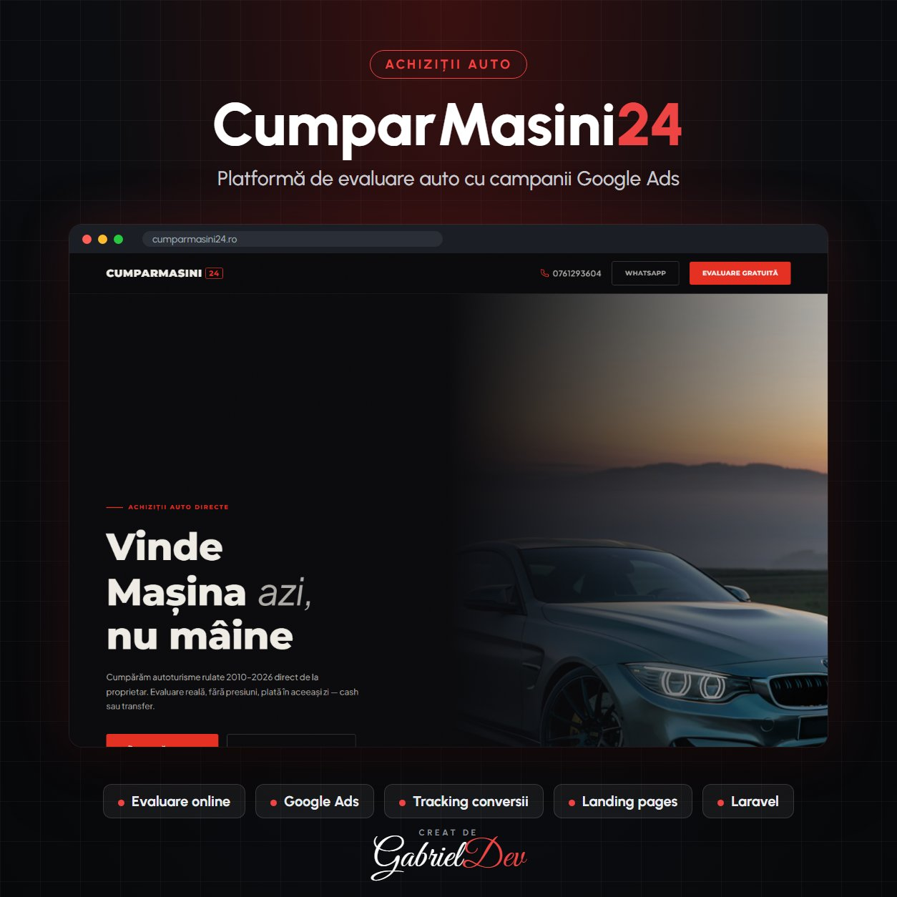

  

<h1 align="center">CumparMasini24 – Platformă Web pentru Achiziții Auto & Campanii Google Ads</h1>

Platformă modernă de achiziții auto cu evaluare online, optimizată pentru conversii, SEO și administrarea campaniilor Google Ads.

| | |
|---|---|
| **Client** | Client privat |
| **An** | 2026 |
| **Domeniu** | Backend Development · Frontend Development |
| **Status** | Live — [cumparmasini24.ro](https://cumparmasini24.ro) |
| **Studiu de caz** | [gabrieldev.eu](https://gabrieldev.eu/portofoliu/cumparmasini24-platforma-web-pentru-achizitii-auto-campanii-google-ads) |

---

## CumparMasini24 – Platformă Web pentru Achiziții Auto & Campanii Google Ads

## Dezvoltare platformă web modernă pentru achiziții auto

CumparMasini24 este o platformă web modernă dezvoltată pentru achiziția rapidă de autoturisme direct de la proprietari. Proiectul a inclus dezvoltarea unei interfețe premium, optimizarea experienței utilizatorului și implementarea unei structuri orientate către conversii.

Pe lângă dezvoltarea platformei, gestionez și strategia de promovare prin **Google Ads**, optimizând constant campaniile pentru generarea de lead-uri și reducerea costului per conversie.

## Servicii realizate

- Dezvoltare website personalizat
- UI/UX Design modern
- Responsive Design
- Mobile First
- Optimizare SEO On-Page
- Optimizare performanță
- Integrare formulare de evaluare auto
- Optimizare pentru conversii (CRO)
- Administrare și optimizare Google Ads
- Monitorizare conversii
- Optimizare Landing Pages

## Rezultate

Platforma este construită pentru a genera cereri de evaluare și apeluri telefonice printr-o experiență rapidă și intuitivă. Campaniile Google Ads sunt optimizate continuu pentru a atrage trafic relevant și pentru a maximiza numărul de conversii la un cost cât mai eficient.

## Tehnologii utilizate

- Laravel
- PHP
- MySQL
- HTML5
- CSS3
- JavaScript
- Google Ads
- Google Analytics
- Google Tag Manager
- Google Search Console

## Servicii oferite

Acest proiect demonstrează experiența GabrielDev în dezvoltarea platformelor web orientate spre conversii și în administrarea campaniilor Google Ads pentru generarea de lead-uri și creșterea vânzărilor.

---

## 🔒 Despre cod

Acesta este un repository de **prezentare**. Codul sursă aparține clientului și nu este public — aici găsești descrierea proiectului, funcționalitățile și tehnologiile folosite.

## 🤝 Ai nevoie de ceva asemănător?

Proiect realizat de **[Gabriel Dev](https://gabrieldev.eu)** — creare site-uri, magazine online și aplicații web personalizate.

- 🌐 [gabrieldev.eu](https://gabrieldev.eu) · [toate proiectele](https://gabrieldev.eu/proiecte)
- ✉️ [contact@gabrieldev.eu](mailto:contact@gabrieldev.eu)
- 📞 [+40 743 543 100](tel:+40743543100)
